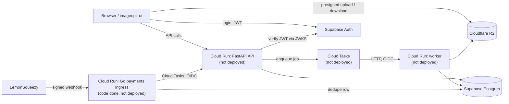

# ImageOpz Server

[](https://github.com/aindrajaya/imageopz-server/actions/workflows/backend-tests.yml)
[](https://github.com/aindrajaya/imageopz-server/actions/workflows/payments-go.yml)

ImageOpz optimises images to AVIF in bulk, with free and Pro tiers (credits, file limits and expiry per tier).
This repository is the FastAPI backend (Pillow/AVIF processing, Cloudflare R2 storage, LemonSqueezy payments,
Supabase Auth); the frontend lives in [aindrajaya/imageopz-ui](https://github.com/aindrajaya/imageopz-ui).

**Status:** migrating to GCP Cloud Run in asia-northeast1 ([ADR-002](docs/engineering/adr/ADR-002-hosting-cloud-run.md)).
The service is offline until T-008; nothing is deployed today.

## Target architecture
Components marked *not deployed* are built or planned but not running anywhere yet.



The worker as a Cloud Tasks HTTP handler, presigned uploads and the Cloud Run deployment are roadmap items
(see below). Today the code still uses a Redis queue and a separate worker process.

## Payments flow
1. The Go ingress verifies the `X-Signature` HMAC over the raw body and refuses everything if the secret is unset.
2. It derives a dedupe key (provider, event name, object type, object id) and inserts it in Postgres in one transaction.
3. A new key is enqueued to the Python API's internal endpoint (Cloud Tasks with OIDC); a seen key answers `duplicate`.
4. The API applies the event idempotently (one activation per order, refunds revoke Pro) in a single transaction.

Details: [ADR-001](docs/engineering/adr/ADR-001-payments-go-ingress.md),
[ADR-004](docs/engineering/adr/ADR-004-payment-event-idempotency.md),
[services/payments-go/README.md](services/payments-go/README.md) (sequence diagram, configuration).

## Engineering practices
- **Characterization tests before changes:** the webhook behavior was pinned before it was refactored
  ([T-001](docs/engineering/tasks/T-001-characterization.md), [tests/test_webhook_characterization.py](tests/test_webhook_characterization.py)).
- **Schema through Alembic only, RLS deny-all enforced by a test:**
  [ADR-003](docs/engineering/adr/ADR-003-postgres-alembic.md), [alembic/versions/](alembic/versions/), [tests/test_rls_deny_all.py](tests/test_rls_deny_all.py).
- **Idempotency and transaction rules for payment events:** [ADR-004](docs/engineering/adr/ADR-004-payment-event-idempotency.md),
  [tests/test_payments_activation.py](tests/test_payments_activation.py).
- **CI on both stacks:** pytest on SQLite and Postgres ([backend-tests.yml](.github/workflows/backend-tests.yml));
  Go vet, golangci-lint, race tests, a Postgres integration job and a Docker build of the ingress image
  ([payments-go.yml](.github/workflows/payments-go.yml)).
- **Protected `main`:** pull request required, with `pytest (sqlite)` and `pytest (postgres)` as required checks
  ([STATE.md](docs/engineering/STATE.md), section "Publication and ruleset").
- **Decisions recorded:** [ADR index](docs/engineering/adr/).
- **AI-assisted development** (Claude Code, Codex) under written task contracts with evidence-based review:
  [AGENTS.md](AGENTS.md), [docs/engineering/tasks/](docs/engineering/tasks/).

## Repository layout
```
app/                 FastAPI app: routes/, services/ (image, payments, email), utils/ (auth, security), workers/
alembic/             migrations (single DDL owner)
services/payments-go Go webhook ingress (own go.mod, Dockerfile, tests)
tests/               pytest suite (SQLite by default, Postgres with TEST_DATABASE_URL)
docs/engineering/    STATE.md, ADRs, task contracts and handoffs, registers.md, runbooks/
docs/openapi.json    generated API spec (python scripts/generate_openapi.py)
issues/              incident notes
```

## Local development
- Run the API and worker: [local-run.md](docs/engineering/runbooks/local-run.md)
- Throwaway Postgres for the Postgres test leg: [local-postgres.md](docs/engineering/runbooks/local-postgres.md)
- Writing and reviewing migrations: [db-migrations.md](docs/engineering/runbooks/db-migrations.md)
- Tests: `pytest -q` (SQLite); `TEST_DATABASE_URL=postgresql+psycopg://... pytest -q` for Postgres.

## Roadmap
Current state and open tasks are in [STATE.md](docs/engineering/STATE.md).
- **T-006:** presigned direct-to-R2 uploads (backend and UI).
- **T-007:** Cloud Tasks worker, remove Redis.
- **T-008:** containers and Cloud Run deployment (migration job, secrets, scheduler, payments ingress service).

## License
All rights reserved; see [LICENSE](LICENSE).
