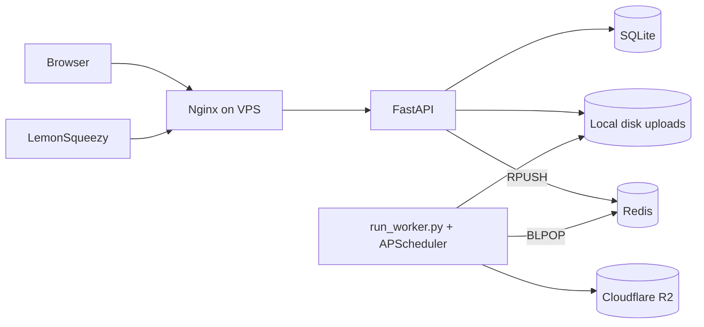
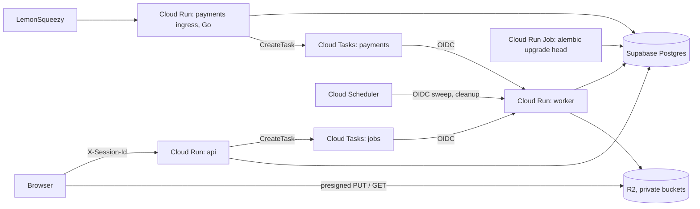

# Case study: Python payments to a Go ingress, VPS to Cloud Run

ImageOpz converts images to AVIF. This note explains how its backend moved from a VPS to Google Cloud Run, and
why payment webhooks now enter through a small Go service. Facts from the first staging run are cited as
"owner, staging run 2026-10-17/18"; they are not yet recorded elsewhere in the repo.

## 1. Context and constraints

Where it started (T-000, ADR-002, ADR-005):
- FastAPI and SQLite on a single VPS, behind systemd and Nginx. No Docker, no CI (T-000 "Facts").
- A Redis list fed a separate worker process (BLPOP), and APScheduler ran cleanup (ADR-005 "Context").
- The schema was created at app start with `create_all` and hand-written `ALTER TABLE` (ADR-003 "Context").
- The VPS was later deleted, so the product was offline (ADR-002 "Context").

The payment recon (T-000 "Findings") found real bugs in the LemonSqueezy webhook:
- A replayed webhook re-activated Pro: credits reset and expiry extended (finding 2, pinned by T-001 tests).
- Refunds were ignored, and a refund event overwrote a paid order's status with "unknown" (finding 7).
- Commits were not atomic, and a 500 response echoed exception text (finding 8).

Goal: run on Cloud Run with Supabase Postgres, and add a Go payments ingress as a production-grade Go proof
(ADR-001 "Context"). Budget: about $10/month of GCP credit (ADR-002). Deadline: Monday 19 Oct 2026 (STATE.md
"Current objective").

## 2. How the work was run

Every change was a bounded task with a written contract: T-000 recon through T-008c2 in this repo, and T-008c3
in the UI repo (STATE.md "Done"). Each task file records the baseline SHA, acceptance criteria, the commands run and
their results. Lasting choices became ADRs (ADR-001 to ADR-005).

An independent reviewer with a fresh context read each diff before acceptance. Example: the T-005 review found
that a NUL byte in an event id caused an endless 503 loop; it was fixed with a test (T-005 "Independent review").
CI requires `pytest (sqlite)` and `pytest (postgres)` on every PR (STATE.md "Repo settings"). Bugs were reproduced
with a failing test first (AGENTS.md "Rules"; T-007, J3 amendment).

The GCP bring-up followed a staged runbook with a STOP after each phase, where the owner pasted the output for
review (docs/engineering/deploy/STAGING-RUNBOOK.md, STOP 0 to STOP 8).

AI-assisted delivery: the Go code, and the Python changes in these tasks, were written by AI coding agents (Claude
Code) from task contracts the owner wrote. The owner set the requirements and the ADR decisions, reviewed every hand-off, ran CI, and operated
the GCP bring-up. The owner is not a fluent Go developer; the Go code is the agents' work, checked against the
owner's contracts and tests. The owner wrote the original FastAPI service before these tasks, using AI to help work through problems.

## 3. Decisions

| Decision | Problem | Options | Choice | Why | Trade-off |
|---|---|---|---|---|---|
| ADR-001 Go ingress | Webhook wrote 4 tables; other code also wrote Pro fields | A: Go ports activation. B: Go writes orders. C: Go only verifies, dedupes, enqueues | C | One writer of users, users_quota, orders (Python); no duplicated matching logic | Extra hop, two services |
| ADR-002 hosting | VPS gone, ~$10/month credit | VM + Compose; Cloud Run + Cloud SQL; Cloud Run + Supabase | Cloud Run + Supabase + R2 + Cloud Tasks | ~$0 at portfolio traffic; Cloud SQL would use most of the credit | Supabase Free pauses after 1 week idle; no Nginx rate limits |
| ADR-003 schema | DDL at startup, SQLite-only, unsafe with many instances | keep `create_all`; Alembic | Alembic owns schema; RLS on, no policies | Supabase Data API exposes `public`; deny-all blocks it | Deploys must migrate first |
| ADR-004 idempotency | No per-delivery id in LemonSqueezy payloads | - | Unique (provider, event, type, id); first write in the same transaction | Replay, alias and out-of-order delivery cannot double-grant | Unprocessable events answer 200 "ignored", not 4xx |
| ADR-005 jobs | Redis removed | - | Cloud Tasks to an HTTP worker, claim with a 30 min lease | At-least-once delivery processes a job at most once | A duplicate during processing retries until the first finishes |
| Presigned uploads (T-006b, T-006b2) | Cloud Run request body max 32 MiB (ADR-002) | old multipart upload through the API; presign | Browser PUTs straight to R2; multipart endpoint removed (T-006b2) | No large bodies through Cloud Run | Abuse bounds are cheap, accepted risk U1 (STATE.md Q6) |
| Presigned downloads (T-008c2, runbook D1) | Outputs served from a public URL (`R2_CUSTOM_DOMAIN`, removed in T-008c2) | public bucket or custom domain; presigned GET (T-008c0) | Private buckets, 15 min links per request | No public object URLs, no DNS record | UI must refresh links (UI2) |
| Header-only sessions (T-008b1, Q2-B) | API and UI on different hosts (run.app) | custom domain; header session | `X-Session-Id` header, cookies off in the UI | No cross-site cookie dependency | Session id lives in the client |
| WIF (ADR-002, deploy/gcloud/80-wif.sh) | CI needs to deploy | not recorded | WIF, tokens accepted only from this repo, `main`, the deploy workflow | No long-lived key to leak | More setup steps |

## 4. Architecture

Before (T-000, ADR-002, ADR-005):



After (ADR-002, ADR-005; services confirmed by owner, staging run 2026-10-17/18):



The api and worker are one Python image; `SERVICE_ROLE` decides which routes mount (ADR-005 amendment 2026-10-17).

Payment path (services/payments-go/README.md; `internal/httpapi/httpapi.go:deliver`):

```mermaid
sequenceDiagram
  participant LS as LemonSqueezy
  participant G as Go ingress
  participant DB as Postgres
  participant Q as Cloud Tasks
  participant W as Python worker
  LS->>G: POST /webhooks/lemonsqueezy (raw body, X-Signature)
  G->>G: HMAC-SHA256 over raw bytes (401 if wrong)
  G->>DB: BEGIN; INSERT webhook_deliveries ON CONFLICT DO NOTHING
  alt row exists
    G-->>LS: 200 duplicate
  else new row
    G->>Q: CreateTask (name = hash of key, OIDC)
    alt enqueue fails
      G->>DB: ROLLBACK
      G-->>LS: 503 (LemonSqueezy retries)
    else ok
      G->>DB: COMMIT
      G-->>LS: 200 accepted
    end
  end
  Q->>W: POST /internal/payments/events (OIDC token)
  W->>DB: claim processed_payment_events, activate or revoke, one transaction
  W-->>Q: 200 processed / duplicate / ignored
```

## 5. Python to Go: what moved and what stayed

Go owns three steps (services/payments-go):
- Verify: `signature.Verify` checks the hex HMAC over the exact raw bytes with `hmac.Equal`.
- Dedupe: `dedupe.Extract` builds the key; `pgTx.Claim` inserts into `payments.webhook_deliveries`.
- Enqueue: `enqueue.CloudTasks.Enqueue` creates a task named after the key's hash; `ALREADY_EXISTS` counts as success.

Python keeps the business rules (`app/services/payments.py:apply_lemonsqueezy_event`), behind
`POST /internal/payments/events` (`app/routes/internal.py:apply_payment_event`). These are R1 to R5 (ADR-001):
activate once per order, refund revokes Pro, other events never overwrite status, one transaction per event, no
exception text in errors.

Why this split:
- One source of business logic. Matching a buyer to a quota stays in one language, so it cannot drift (ADR-001,
  option A risk).
- Delivery is at least once. LemonSqueezy and Cloud Tasks both retry on any non-2xx (ADR-004 "Consequences"). So both
  layers dedupe: Go per delivery, Python per event (`_claim_event`). This is defence in depth (ADR-001).
- Retries are safe. A failed enqueue rolls the claim back, so the sender's retry counts as new. A commit that fails
  after a successful enqueue is absorbed by the task name or by Python's idempotency (`httpapi.go:deliver` comment).

## 6. Results

Staging (owner, staging run 2026-10-17/18):
- Live on Cloud Run in asia-northeast1: api, worker, Go payments ingress, migrate job; Supabase Postgres in Tokyo;
  R2 private buckets; Cloud Tasks for jobs and payments; Cloud Scheduler for sweep and cleanup; WIF CI deployer;
  7 alerts.
- CI deploy run 39042525989: tests, build, migrate, staging rollout and smoke test. The prod approval was rejected
  on purpose.
- Payment: test webhook, Go ingress 200, Cloud Tasks, worker 200 in about 0.5 s, Pro activated (1 paid order,
  1 delivery row, 1 processed event). A resend got 200 `{"status":"duplicate"}`, no new task, counts unchanged. An
  unsigned webhook got 401.
- Images: a 37.8 MB PNG (13.2 MP) became a 9.93 MB AVIF in 20.3 s. A free upload over 10 MB got 413
  `FILE_TOO_LARGE` from the server. Download links expired after 15 minutes (200 then 403); unsigned bucket access
  failed (400).
- Ops: internal routes 404 on the public api; the worker 404s from the internet even with a Google token; the
  kill switch drill passed.

Tests:
- Python: 197 passed / 13 skipped on SQLite, 210 passed on Postgres (T-008c2 "Handoff"). It started at 15 (T-001).
- Go: 16 unit test functions, many table-driven, plus 3 Postgres integration tests (`services/payments-go/internal/**/*_test.go`),
  run with `-race` in `.github/workflows/payments-go.yml`.

## 7. What broke and what I learned

Findings during bring-up (owner, staging run 2026-10-17/18):
- A database password containing `@` broke the connection URL. Fix: percent-encode it.
- The Go ingress refuses to start until migration 0003 exists (`pgstore.go:OpenPG` probes the table). This is by
  design, but it fixes the deploy order: migrate first.
- A `gcloud` prompt made services public too early. It was undone.
- Smaller ones: Supabase's Site URL defaults to localhost; Vercel `VITE_` variables must be "Config".

Open production blocker, the poison job. A 2.8 MB JPEG of 168 megapixels passes `/uploads/complete` and the worker
is OOM-killed at 4 GiB (signal 9). The task is retried under the lease again and again (owner, staging run
2026-10-17/18). Why it passes: the pixel cap is 250 MP (`app/config.py:max_image_pixels`), and a small file can
decode to a huge bitmap. Why it repeats: ADR-005 answers 503 during a live lease and reclaims after it expires, so a
job that always crashes is always retried until the sweeper FAILs it at twice the lease. Planned fix: a pixel cap
measured against worker memory, and a cap on processing attempts that fails the job and refunds the credit (ADR-005
already lists the refund policy as a follow-up).

Lessons:
- Retries are only safe if every step is idempotent. Designing that first (ADR-004) made the payment test boring.
- A file-size limit does not bound decoded memory. Bound work by what it costs.
- A retry policy needs a stop rule. To a queue, crash recovery and a poison job look the same.
